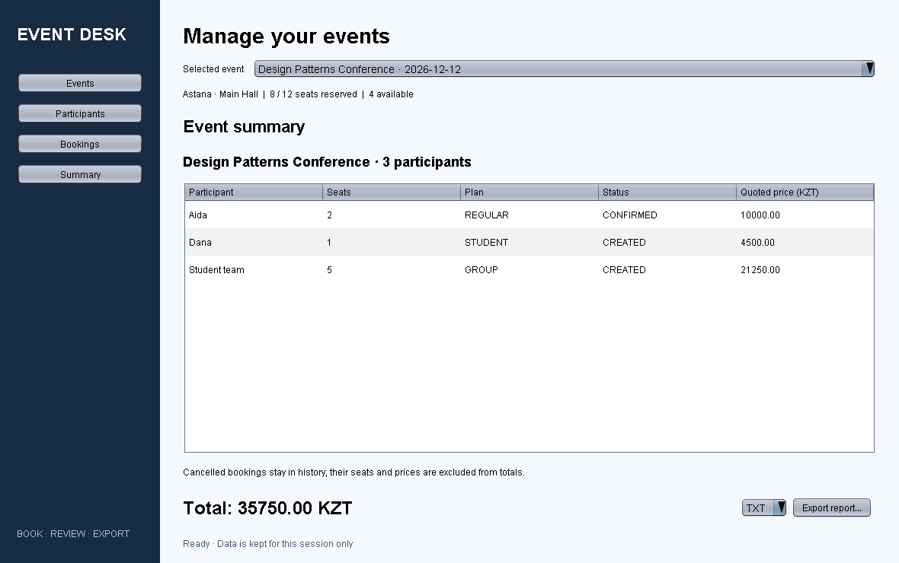

# Event Desk

Java 25 / Maven / Swing application for events, participants, bookings and summary exports.
Work branch: `feature/gui-facade`, based on `feature/booking-storage` at `a924bcb`.

## Build and run

Install a JDK 25 and Maven 3.9+. Ensure `JAVA_HOME` points to JDK 25 and `java -version` reports 25.

```sh
mvn clean verify
java -jar target/final_project_sdp-1.0-SNAPSHOT.jar
```

The default launch loads demo data. To start an empty session:

```sh
java -jar target/final_project_sdp-1.0-SNAPSHOT.jar --empty
```

In IntelliJ IDEA, open `pom.xml`, choose JDK 25 for both the project and Maven runner, reload Maven,
and run `org.example.Main`. No database or external runtime libraries are required.
The runnable JAR contains the application; JUnit is a test dependency only.

## Using the interface

1. **Events**: create an event with date, venue, positive capacity and nonnegative ticket price.
2. **Participants**: register booking holders by name.
3. Choose an event in the selector at the top of any page.
4. **Bookings**: choose a participant, seat count and pricing plan. Use **Book seats**.
5. Select a booking row, choose a status and use **Apply status**.
6. **Summary**: review bookings and the total, select TXT/JSON/HTML and use **Export report…**.
   Choose a destination; an existing report requires replacement confirmation. Errors use one shared dialog.

All amounts are in KZT. A participant is the registered booking holder; a group booking can reserve
multiple seats under one participant. Names need not be unique; IDs distinguish participants.
`CREATED` and `CONFIRMED` reserve seats. `CANCELLED` releases seats and contributes zero to the total;
the historical quoted price remains visible. Restoring a cancelled booking checks capacity again.
Student pricing is 10% off; group pricing is 15% off for at least five seats. Prices use `BigDecimal`.

**Storage is in memory for one application session. Closing the app discards changes.**
Reports are persistent output files, not backups that can be imported.

## Demo data and scenarios

| Event | Capacity | Reserved | Total (KZT) |
| --- | ---: | ---: | ---: |
| Design Patterns Conference | 12 | 8 | 35750.00 |
| Java Workshop | 3 | 3 | 6000.00 |
| Community Meetup | 20 | 0 | 0.00 |

**Scenario 7 - export:** open Summary for the conference and export each format. Expected:
three booking holders, three bookings, eight reserved seats, total **35750.00 KZT**.
TXT is readable text, JSON is structured UTF-8 data, HTML is a standalone browser report.

**Scenario 8 - over capacity:** select Java Workshop, choose any participant, REGULAR and one seat.
Use Book seats. Expected: error `requested 1, available 0`; the original booking and total remain unchanged.



## Architecture and patterns

```text
Main -> SampleData -> EventFacade
GUI -> EventFacade -> EventService / BookingService -> InMemoryEventStore
                   -> PriceCalculator -> existing PricingStrategy implementations
                   -> ExporterFactory -> ReportExporter -> TXT / JSON / HTML
```

- **Facade:** GUI actions only use `EventFacade` for application operations; model records carry data.
- **Factory Method:** abstract Creator `ExporterFactory` declares `createExporter(format)`;
  `DefaultExporterFactory` overrides it to select `TxtExporter`, `JsonExporter` or `HtmlExporter`.
  The creator's `export` operation calls the overridden factory method. A test proves that a different
  creator implementation can replace exporter creation without changing that operation.
- **Strategy (existing):** `RegularPricing`, `StudentDiscountPricing`, `GroupDiscountPricing` and
  `PriceCalculator` are retained unchanged and called by the booking service.

Packages: `booking`, `pricing` (existing), `model`, `storage`, `service`, `export`, `facade`, `sample`, `ui`.
`Summary` is an immutable snapshot. Capacity validation and saving occur within one store lock.
Export writes a temporary UTF-8 file beside the destination and then replaces the destination,
using an atomic move when supported by the filesystem.

## Verification and documentation

`mvn clean verify` runs factory, facade, export, capacity, concurrency, GUI action and existing pricing tests.
GitHub Actions repeats verification on Java 25 for pushes and pull requests.

- [Project report](docs/REPORT.md): introduction, architecture, pattern table, actual code extracts,
  scenarios, verification, conclusion and Future Work.
- [PDF report](docs/Final-Report.pdf).
- [Scenario instructions and verification limits](docs/SCENARIOS.md).
- [Screenshots and sample exports](docs/screenshots/).

The images are reproducible offscreen captures of actual Swing components, not design mockups.
Generate them after compiling tests (Windows classpath separator is `;`, Linux/macOS uses `:`):

```sh
java -Djava.awt.headless=true -cp "target/classes;target/test-classes" org.example.ui.ScreenshotCapture
```

The supplied `Final Report.pdf` was a formatting reference for another project. Its classes,
patterns, metrics, authors and results are not attributed to this application.
