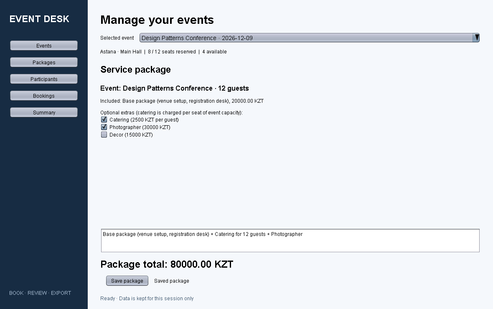
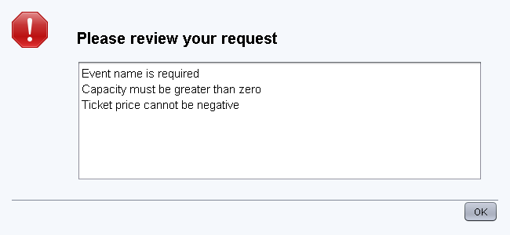

# Event Desk

## Design Patterns Implementation Project Report

Repository: Ruslankyzy-Aldina/final_project_sdp
Contribution branches: feature/gui-facade, feature/model-builder
Baseline: a924bcb, feature/booking-storage
Verification date: 8 November 2026

## 1. Introduction

### 1.1 Background

Event registration combines capacity rules, pricing, booking status changes and reporting.
If a graphical interface implements those rules itself, every screen becomes coupled to storage
and calculation details. Event Desk separates these responsibilities using a facade, exporter
creation through Factory Method, and the pricing strategies already present in the repository.

### 1.2 Objectives

- Preserve the existing Booking model, statuses, pricing strategies and tests.
- Provide a graphical workflow for events, participants, bookings and summaries.
- Export the same summary to TXT, JSON and HTML through a common interface.
- Reject over-capacity bookings without partially changing application state.
- Supply demo data, repeatable tests and documented demonstration scenarios.

### 1.3 Scope

This contribution is a Java 25 desktop application using Swing and Maven. It implements
Factory Method, Facade, Builder and Decorator and integrates the existing Strategy pattern. It does not claim
to implement the six patterns or document-conversion features described in the supplied
formatting example. Team names and course group details are not invented in this report.

## 2. Project Overview

The inspected baseline contained Booking, BookingStatus, PriceCalculator, three pricing
strategies, two JUnit tests and a placeholder Main. There were no event or participant models,
storage services, GUI or report files. feature/gui-facade added those layers without changing the
existing booking and pricing source files. feature/model-builder later changed only the exception
type thrown by Booking and GroupDiscountPricing to ValidationException (a subclass of
IllegalArgumentException), so their behavior and tests are unchanged.

Users can create events, register participants, reserve seats, change booking status, view
an immutable summary and save a report. Demo data contains three events and three participants.
The conference has eight reserved seats out of twelve and a total of 35750.00 KZT.
The workshop deliberately has no available seats so scenario 8 can be demonstrated immediately.

## 3. Design Patterns Implementation

### 3.1 Pattern table

Responsible students are listed by repository account; replace with full names before submission.

| Pattern | Problem it solves | Main classes/interfaces | How to demonstrate it | Responsible student |
| --- | --- | --- | --- | --- |
| Strategy | Booking price depends on a plan chosen by the user; formulas must be swappable without `if` chains | PricingStrategy, RegularPricing, StudentDiscountPricing, GroupDiscountPricing, PriceCalculator | Bookings: book the same seats with REGULAR, STUDENT and GROUP and compare prices | Ruslankyzy-Aldina |
| Factory Method | The summary must be saved in several formats chosen at run time | ReportExporter, TxtExporter, JsonExporter, HtmlExporter, ExporterFactory, DefaultExporterFactory | Summary: export the conference as TXT, JSON and HTML | akmaralabilhayir-lab |
| Facade | GUI screens would otherwise depend on storage, services, pricing and exporters directly | EventFacade, EventService, BookingService, InMemoryEventStore | Every button in the GUI calls one EventFacade method | akmaralabilhayir-lab |
| Builder | An event has six fields entered in a form in any order; all must be validated together, and editing must keep the id. A six-argument constructor is error-prone (capacity and price swapped silently) | Event (product), EventBuilder: `name()`, `date()`, `location()`, `capacity()`, `price()`, `build()`; EventService (director) | Events: create an event, select it, change capacity, Save changes; create with an empty name to see all messages from `build()` | konys_r |
| Decorator | Extras (catering, photographer, decor) can be combined freely; one subclass per combination would need 2^3 = 8 classes | ServiceOption, BasePackage, OptionDecorator, CateringDecorator, PhotographerDecorator, DecorDecorator, ServicePackage | Packages: tick extras; the description and total update after each tick and are saved with Save package | konys_r |

### 3.2 Factory Method

ReportExporter is the product interface. Each concrete product serializes the same Summary.
ExporterFactory is an abstract Creator, while DefaultExporterFactory is its concrete subclass.
The public export operation invokes createExporter, so object creation can vary independently
of the operation. This explicit creator hierarchy avoids describing a static switch alone as
the entire Factory Method pattern. The concrete creator accepts a normalized format string.

```java
public interface ReportExporter {
    void export(Summary summary, Path path) throws IOException;
}

public abstract class ExporterFactory {
    public abstract ReportExporter createExporter(String format);

    public final void export(Summary summary, Path path, String format)
            throws IOException {
        createExporter(format).export(summary, path);
    }
}
```

The concrete method returns TxtExporter for txt, JsonExporter for json and HtmlExporter for
html; unknown formats fail before touching the destination. ExporterFactoryTest also substitutes
a custom creator to prove the export operation dispatches through the overridden method.
Adding a new built-in format requires a new product, a concrete-creator mapping and a GUI option;
the facade and existing exporters do not change.

### 3.3 Facade

EventFacade constructs and coordinates the service layer and exposes createEvent, addParticipant,
addBooking, changeStatus, getSummary and exportSummary. The GUI imports the facade and data
types, without directly calling storage, pricing implementations or exporters.

```java
public BookingDetails addBooking(String eventId, String participantId,
                                 int seats, PricingPlan plan) {
    return bookings.addBooking(eventId, participantId, seats, plan);
}

public BookingDetails changeStatus(String bookingId, BookingStatus status) {
    return bookings.changeStatus(bookingId, status);
}

public Summary getSummary(String eventId) {
    return events.getSummary(eventId);
}

public void exportSummary(String eventId, String format, Path path)
        throws IOException {
    exporters.export(getSummary(eventId), path, format);
}
```

These excerpts correspond to the actual classes; only imports, unrelated methods and comments
are omitted. Constructor injection of the store and factory supports isolated testing and
alternative creators without exposing those details to the GUI.

### 3.4 Builder

`Event` used to be a record with a public six-argument constructor. In the GUI the values arrive
one field at a time as text, some may be missing, and an edit must produce a new immutable event
with the same id. The Builder separates collecting values from validating and constructing the
product. The `Event` constructor is package-private and takes the builder, so `EventBuilder.build()`
is the only way to obtain an event; an invalid `Event` cannot exist.

```java
public final class EventBuilder {
    public EventBuilder name(String name) { this.name = name; return this; }
    public EventBuilder date(LocalDate date) { this.date = date; return this; }
    public EventBuilder location(String location) { this.location = location; return this; }
    public EventBuilder capacity(int capacity) { this.capacity = capacity; return this; }
    public EventBuilder price(BigDecimal price) { this.price = price; return this; }

    public Event build() {
        List<String> errors = new ArrayList<>();
        name = trimToNull(name);
        location = trimToNull(location);
        if (name == null) errors.add("Event name is required");
        if (location == null) errors.add("Location is required");
        if (date == null) errors.add("Event date is required");
        else if (date.isBefore(LocalDate.now(clock))) errors.add("Event date cannot be in the past");
        if (capacity <= 0) errors.add("Capacity must be greater than zero");
        if (price == null) errors.add("Ticket price is required");
        else if (price.signum() < 0) errors.add("Ticket price cannot be negative");
        if (!errors.isEmpty()) throw new ValidationException(errors);
        id = trimToNull(id) == null ? UUID.randomUUID().toString() : id.trim();
        price = price.setScale(2, RoundingMode.HALF_UP);
        return new Event(this);
    }
}
```

`EventService` acts as the director for both create and edit. Editing starts from
`event.toBuilder()`, which pre-fills every field and keeps the id:

```java
public Event createEvent(String name, LocalDate date, String venue, int capacity, BigDecimal price) {
    Event event = Event.builder().clock(clock)
            .name(name).date(date).location(venue).capacity(capacity).price(price)
            .build();
    store.addEvent(event);
    return event;
}

Event updated = store.event(id).toBuilder().clock(clock)
        .name(name).date(date).location(venue).capacity(capacity).price(price)
        .build();
```

Excerpts are from the actual classes, with a name-length check and comments omitted.
The `Clock` lets tests fix "today" for the past-date rule.
Limitation: the builder is mutable and not thread-safe; it is meant to be used once by one caller.

### 3.5 Decorator

A service package starts with a base package. Each selected extra wraps the current option in a
decorator that adds its own cost and description. The client works only with `ServiceOption`
and cannot tell how many layers there are. A new extra is one new subclass of
`OptionDecorator`; no existing class has to change.

```java
public interface ServiceOption {
    BigDecimal getCost();
    String getDescription();
}

public abstract class OptionDecorator implements ServiceOption {
    private final ServiceOption wrapped;

    protected OptionDecorator(ServiceOption wrapped) {
        this.wrapped = Objects.requireNonNull(wrapped, "wrapped option");
    }
    protected abstract BigDecimal extraCost();
    protected abstract String extraDescription();

    @Override public final BigDecimal getCost() { return wrapped.getCost().add(extraCost()); }
    @Override public final String getDescription() {
        return wrapped.getDescription() + " + " + extraDescription();
    }
}

public final class CateringDecorator extends OptionDecorator {
    public static final BigDecimal PRICE_PER_GUEST = new BigDecimal("2500.00");
    private final int guests;
    public CateringDecorator(ServiceOption wrapped, int guests) {
        super(wrapped);
        if (guests <= 0) throw new ValidationException("Catering needs at least one guest");
        this.guests = guests;
    }
    @Override protected BigDecimal extraCost() { return PRICE_PER_GUEST.multiply(BigDecimal.valueOf(guests)); }
    @Override protected String extraDescription() { return "Catering for " + guests + " guests"; }
}
```

The package screen's checkboxes are turned into a decorator chain:

```java
public static ServicePackage configure(Event event, Set<ServiceExtra> selected) {
    Set<ServiceExtra> extras = selected == null || selected.isEmpty()
            ? EnumSet.noneOf(ServiceExtra.class) : EnumSet.copyOf(selected);
    ServiceOption option = new BasePackage();
    for (ServiceExtra extra : extras) option = extra.decorate(option, event.capacity());
    return new ServicePackage(event.id(), List.copyOf(extras), option);
}
```

For the sample conference (12 guests), catering and photographer give
20000 + 12 x 2500 + 30000 = 80000.00 KZT; adding decor gives 95000.00 KZT.
`OptionDecorator` makes `getCost()` and `getDescription()` final and asks subclasses only for their
own part, so a subclass cannot forget to delegate to the wrapped option. Limitations: the GUI
offers each extra once, but the API allows wrapping the same decorator twice; and package
cost is shown on the package screen, not yet included in the exported summary.

## 4. System Architecture

Event Desk has three layers. The GUI parses and displays data. The application layer
(facade and services) applies the rules. The storage layer keeps the data. Each layer only calls the one below it.

```text
Main / SampleData
        |
Swing GUI: EventPanel
   |-- EventListPage (events: list, create, edit, delete)
   |-- PackagePage   (service package and extras)
   |-- participants, bookings, summary pages
        |  (every action)
        v
EventFacade
   |-- EventService ---- EventBuilder ---> Event              (Builder)
   |        |       ---- ServicePackage -> ServiceOption chain (Decorator)
   |        v
   |   InMemoryEventStore (events, participants, bookings, packages)
   |-- BookingService -> PriceCalculator -> PricingStrategy     (Strategy)
   |        |
   |        v
   |   InMemoryEventStore
   |-- ExporterFactory -> ReportExporter -> TXT / JSON / HTML   (Factory Method)
```

| Package | Responsibility |
| --- | --- |
| `ui` | Swing screens. `FormInput` turns text into dates and numbers; screens call only `EventFacade` |
| `facade` | `EventFacade`, the single entry point for GUI actions |
| `service` | `EventService` (events, packages, summaries) and `BookingService` (bookings, capacity, status) |
| `model` | Event and its builder, Participant, ServicePackage, BookingDetails, Summary |
| `booking` | Booking record and BookingStatus |
| `option` | Decorator participants for service packages |
| `pricing` | Strategy participants for ticket prices |
| `export` | Factory Method participants for report formats |
| `validation` | `ValidationException`, shared by all layers |
| `storage` | `InMemoryEventStore` |
| `sample` | Demo data loaded at start |

**Validation flow.** Validation happens in three places, and all of them report through
`ValidationException`. It extends `IllegalArgumentException` and stores a list of messages.
1. Format: `FormInput` in the GUI rejects text that is not a number or a date, for example
   "Capacity must be a whole number".
2. Field values: `EventBuilder.build()`, `Booking`, `Participant` and `BasePackage` check for
   empty names, a past date, zero or negative capacity, and a negative price. The builder
   returns every problem it finds in one exception.
3. Application rules: the services enforce rules that depend on stored data. A booking cannot
   exceed capacity. Capacity cannot be reduced below the seats already reserved. An event with
   active bookings cannot be deleted. A group discount needs at least five seats.

`ErrorDialog` shows all messages to the user. The application state is not changed when validation fails.

**Data and concurrency.** Records and `Event` are immutable. Edits replace the stored object. A `Summary` copies its collections.
Compound operations (book, change status, update/delete event, save package) hold the store lock,
so capacity checks and writes are atomic. Storage is local to one facade session.
When an event's capacity changes, its saved package is rebuilt, because catering is charged per guest.

## 5. Implementation Details

### 5.1 Pricing, participants and status rules

Each participant is a registered booking holder. Group bookings reserve multiple seats without
requiring a separate record for every guest. IDs distinguish participants with identical names.
Prices use the existing BigDecimal calculations: regular full price, student 10% discount,
and group 15% discount when at least five seats are booked. Quoted totals are retained per booking.

CREATED and CONFIRMED both reserve capacity and contribute to the summary total. CANCELLED
retains history but releases seats and contributes zero. Reactivation is allowed only when the
original seat count fits. Reapplying the same active status does not reserve seats a second time.

### 5.2 Export and error handling

All reports use UTF-8. JSON escapes quotes, backslashes, control characters and surrogate code
units. HTML escapes dynamic text, keeping user-entered markup as text. Monetary values are
decimal numbers; the exported currency is KZT. Cancelled bookings remain visible with their
quoted price while the report total excludes them.

Export writes to a temporary file beside the target and then replaces the target, using an
atomic move where available. Temporary files are cleaned up on failure. The GUI confirms
replacement of an existing report and uses a background worker for file output. Validation and
I/O exceptions are shown through ErrorDialog, with actionable messages and no stack trace in
the user-facing dialog.

### 5.3 GUI and navigation

The sidebar switches between Events, Participants, Bookings and Summary. A shared event
selector keeps the current context visible. Tables are read-only, booking actions refresh
totals, and an empty session disables summary export until an event exists.


Figure 1. Event creation form and shared navigation. Image captured from actual Swing components.


Figure 2. Booking list, participant selection, pricing plan and status actions.



Figure 2a. Service package configured with decorators: description and total of the chain.



Figure 2b. All messages collected by EventBuilder for an empty name, zero capacity and negative price.

## 6. User Scenarios

Scenarios 1-6 cover event creation, participant registration, regular/student/group booking
and status changes. Full step-by-step instructions are in SCENARIOS.md. The required scenarios
7 and 8 are described below with concrete expected outcomes.

### 6.1 Scenario 7: export the selected event summary

Launch the demo, select Design Patterns Conference and open Summary. The rows are Aida,
two regular seats at 10000.00; Dana, one student seat at 4500.00; and Student team, five group
seats at 21250.00. The resulting total is 35750.00 KZT, with eight reserved and four available seats.

Select TXT, JSON or HTML, press Export report and choose a writable destination. Each exported
file includes the event, participant identifiers, booking details and the same total. Repeat for
all three formats. Cancelling the file chooser should create no file; declining replacement
should preserve an existing file. These native-dialog interactions remain a manual checklist.


Figure 3. Summary and export controls for the sample conference.

### 6.2 Scenario 8: booking beyond capacity

Select Java Workshop, which already reserves all three seats. Attempt to book one additional
REGULAR seat. The service rejects it with requested 1, available 0. The shared error dialog is
displayed; no extra booking is saved and the original 6000.00 KZT total remains unchanged.

Cancel the original booking to release its seats. After adding a new one-seat booking, trying
to restore the original three-seat booking fails because only two seats remain. This guards
the status-change path as well as the initial booking path.


Figure 4. Actual shared error component populated with the exception raised by scenario 8.

## 7. Testing and Results

The feature/gui-facade suite was compiled and tested locally with OpenJDK 25.0.1 and Maven
(21 tests). After feature/model-builder the suite has 44 tests with zero failures, errors or
skips, run with Maven 3.9.9 on Temurin 21.0.13 with the compiler level overridden to 21
(`-Dmaven.compiler.source=21 -Dmaven.compiler.target=21`). CI runs it on Java 25.

| Test suite | Tests | Coverage |
| --- | ---: | --- |
| PriceCalculatorTest | 2 | Existing pricing strategies and minimum group size |
| ExporterFactoryTest | 4 | Product types, invalid formats, overridden creator dispatch and escaping |
| EventFacadeTest | 13 | Three export formats, overflow, cancellation/reactivation, validation, snapshots, independent events, sample data, I/O failure, overwrite and concurrency |
| EventPanelTest | 2 | Navigation, booking/status button actions and empty-session behavior |
| EventBuilderTest | 5 | Builder: step-by-step build, call order, toBuilder edit, all errors collected, missing date |
| ServiceOptionDecoratorTest | 4 | Decorator: base price, price with three extras, wrapping order, invalid input |
| EventScenarioTest | 12 | Scenarios 1, 5, 6; past date; capacity below reserved; delete rule; package recalculation |
| EventListPageTest | 2 | GUI create/edit/delete on the Events screen; package preview and save on the Packages screen |

The build produces a runnable JAR with org.example.Main as its manifest entry point.
GitHub Actions is configured to repeat Maven verification on Java 25 when the branch is pushed.
No remote CI result is claimed in this report. The original booking/pricing tests pass unchanged;
the only change to that code is the ValidationException type described in section 2.

Screenshots were rendered using printAll on actual Swing components on the event dispatch
thread. They are reproducible offscreen captures, not mockups. They do not prove desktop window
behavior or operating-system file chooser interaction. Those limits and manual checks are
explicitly recorded in SCENARIOS.md. No performance benchmark is claimed.

## 8. Conclusion

This contribution turns the existing booking and pricing foundation into a runnable event
management demonstration. Factory Method separates report creation from export use; Facade
provides the GUI with a consistent entry point; existing strategies continue to calculate prices.
Capacity checks apply both to new bookings and reactivation, while summaries preserve a stable
view of the data. Automated tests establish the expected behavior for the required scenarios.

The main limitation is session-only storage. The application is suitable for demonstrating
design patterns and local workflows, not yet for a shared production booking service. The
report documents these boundaries instead of attributing unrelated functionality from the example.

## 9. Future Work

- Add durable storage with migrations and transaction-level capacity constraints.
- Add participant contact details, distinct group guest lists and booking search.
- Introduce event lifecycle rules, richer status transitions and configurable pricing policies.
- Add report import, PDF export and a format registry if the set of exporters grows.
- Add end-to-end desktop tests for file selection, cancellation and overwrite confirmation.
- Add localization, accessibility review and keyboard navigation checks on target platforms.
- Add authentication, audit history and multi-user concurrency only when a shared service is needed.

## 10. Reproduction

```sh
mvn clean verify
java -jar target/final_project_sdp-1.0-SNAPSHOT.jar
```

Use --empty for an empty session. Use the ScreenshotCapture test utility described in README
to regenerate the images and sample TXT/JSON/HTML reports. This report uses the supplied
Final Report.pdf only as a reference for numbered sections, pattern explanations, code excerpts,
test results, conclusion and future-work structure.
