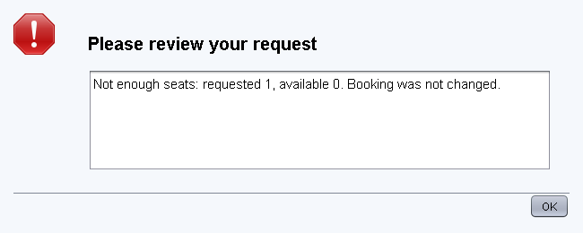
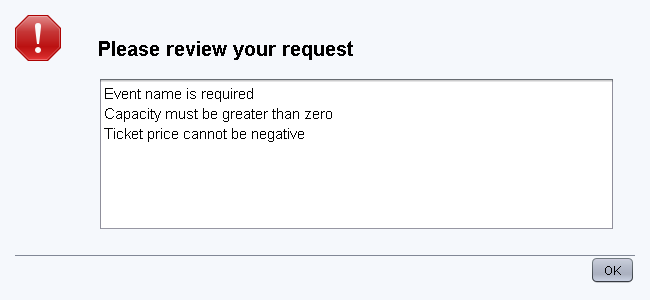

# User scenarios and verification

Use a fresh demo launch unless a scenario specifies otherwise. The application is a local,
single-session event desk. A participant is a booking holder, not a list of every guest in a group.

| No. | Action | Expected result |
| --- | --- | --- |
| 1 | Events: create an event with a valid date, name, venue, capacity 10 and price 1000 | Event is selected and shows 10 available seats |
| 2 | Participants: add a name | A registered participant is available in the booking selector |
| 3 | Book 2 REGULAR seats for the new event | CREATED booking, price 2000.00 KZT, 8 seats available |
| 4 | Book 1 STUDENT seat | Price 900.00 KZT |
| 5 | Book 5 GROUP seats | Price 4250.00 KZT; 4 or fewer group seats are rejected |
| 6 | Select a booking and apply CONFIRMED, then CANCELLED | Confirmation keeps seats reserved; cancellation releases them and removes its price from the total |
| 7 | Export the conference summary to TXT, JSON and HTML | Each file contains the selected event, participants, bookings and total 35750.00 KZT |
| 8 | Add 1 REGULAR seat to the already full Java Workshop | Shared error dialog: requested 1, available 0; no new booking, unchanged total 6000.00 KZT |

## Scenario 7 - detailed steps

1. Launch the demo, choose Design Patterns Conference, open Summary.
2. Check Aida (2 seats, 10000.00), Dana (1 seat, 4500.00), Student team (5 seats, 21250.00).
3. Select TXT, choose Export report, save to a writable folder and open the UTF-8 file.
4. Repeat for JSON and HTML. Open HTML in a browser and parse JSON with a JSON reader.
5. Confirm 8 reserved, 4 available and a total of 35750.00 in each format.
6. Repeat using an existing filename. Declining replacement leaves the file unchanged.
7. Cancel the save dialog. No file should be written.
8. Try a destination without write permission. The shared dialog should explain that saving failed.

Automated evidence: `EventFacadeTest.scenario7ExportsSummaryInSelectedFormat` runs for all three
formats. Other tests cover overwrite, unsupported format, missing destination directory, cleanup,
escaping and unchanged data after an I/O error. Native file chooser cancellation/replacement
interaction is a manual checklist; offscreen tests do not exercise an operating-system dialog.

## Scenario 8 - detailed steps

1. Select Java Workshop. The header shows 3 / 3 reserved and 0 available.
2. Open Bookings, choose Aida, 1 seat and REGULAR. Press Book seats.
3. Read the capacity error, dismiss it and confirm that the booking table has not changed.
4. Cancel the original 3-seat booking and add one seat successfully.
5. Try to reactivate the original booking. It is rejected because only 2 seats remain.

Automated evidence: capacity rejection compares the entire before/after Summary for equality.
Cancellation/reactivation and concurrent booking tests exercise the same service path.

## Test scenarios: event model, Builder and Decorator (feature/model-builder)

These test-scenario numbers are the test plan IDs from the task assignment. They are not the
user-journey numbers in the table above. Actual results come from `mvn verify` (44 tests, 0 failures)
and from the GUI captures in `screenshots/`.

| ID | Input | Expected result | Actual result | Automated test |
| --- | --- | --- | --- | --- |
| S1 - main successful path | Events: create "Spring Gala", date in 30 days, "Main Hall", capacity 10, price 1000. Select it, change capacity to 12 and price to 1200, Save changes. Packages: tick Catering, Photographer, Decor, Save package. Add participant Aida, book 2 REGULAR seats | Event listed and editable with the same id; package total 20000 + 12 x 2500 + 30000 + 15000 = 95000.00 KZT; summary 2 reserved seats, total 2400.00 KZT | As expected | `EventScenarioTest.scenario1MainSuccessfulPath`, `EventListPageTest` |
| S5 - empty event name | Events: name "   " (spaces only), other fields valid, Create event | Error dialog "Event name is required"; no event is added | As expected | `EventScenarioTest.scenario5EmptyEventNameIsRejected` |
| S6 - zero/negative capacity or price | Capacity 0, capacity -5, price -1, and capacity 0 with price -1 | "Capacity must be greater than zero" and/or "Ticket price cannot be negative", all in one dialog; nothing saved. Price 0 is accepted (free event, e.g. Community Meetup) | As expected | `EventScenarioTest.scenario6*` (4 parameterized cases + free event) |

Additional rule checks covered by `EventScenarioTest` and `EventBuilderTest`: a date in the past
(on create and edit), lowering capacity below reserved seats, deleting an event with active
bookings, non-numeric capacity/price or a malformed date (`FormInput`), and recalculating catering
when capacity changes.

## Verification scope

The Maven suite checks domain behavior, exporter creation, saved file contents, error paths,
immutable snapshots, independent events, demo totals and Swing button actions on the EDT.
Screenshots are rendered from the actual components in headless mode using `printAll`.
They verify layout but are not a recording of a desktop session. The native file chooser and
platform window decorations have not been exercised by those headless checks.
