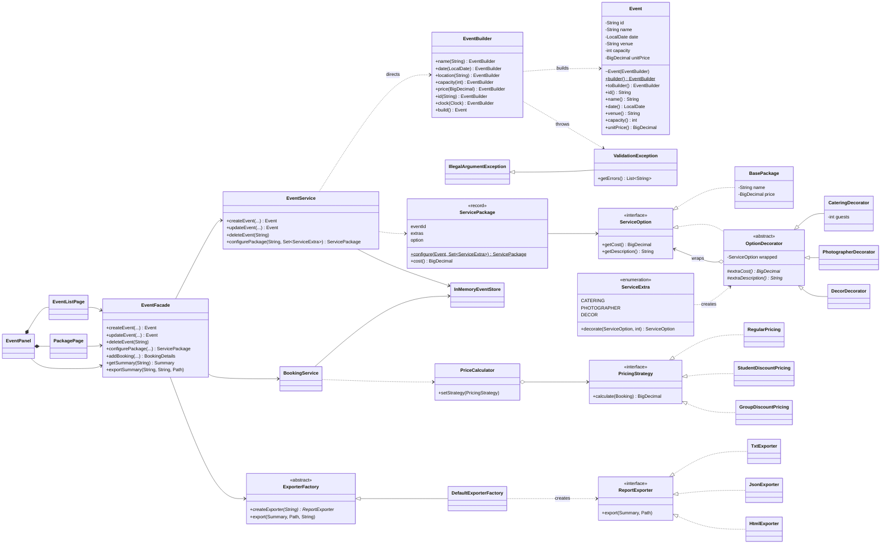

# Class diagram: design patterns

Covers every pattern implemented so far: Builder, Decorator, Facade, Factory Method and Strategy.
The diagram renders on GitHub (Mermaid). The same model is in `class-diagram.puml` for PlantUML/IntelliJ.

## Pattern participants

| Pattern | Role | Class |
| --- | --- | --- |
| Builder | Product | `Event` (private-package constructor, only built through the builder) |
| Builder | Builder | `EventBuilder` (`name()`, `date()`, `location()`, `capacity()`, `price()`, `build()`) |
| Builder | Director / client | `EventService.createEvent` / `updateEvent`, called from `EventListPage` through `EventFacade` |
| Decorator | Component | `ServiceOption` |
| Decorator | Concrete component | `BasePackage` |
| Decorator | Decorator | `OptionDecorator` |
| Decorator | Concrete decorators | `CateringDecorator`, `PhotographerDecorator`, `DecorDecorator` |
| Decorator | Client | `ServicePackage.configure`, driven by `PackagePage` checkboxes |
